<div align="center">
  
  <h1>OpenVI</h1>
  <p><strong>An unofficial, open-source explorer and data-mining toolkit for GTA VI files, in the spirit of OpenIV.</strong></p>
  <p>Browse the folders and RPF9 archives of your own install, look inside them, and catalog what the game holds.</p>
  <p><a href="https://theobiet.github.io/OpenVI/">Website</a> · <a href="https://github.com/TheoBIET/OpenVI/releases">Releases</a> · <a href="CHANGELOG.md">Changelog</a></p>

[](LICENSE)
[](#roadmap)
[](https://v2.tauri.app)
[](#built-by-ai)

</div>

<p align="center">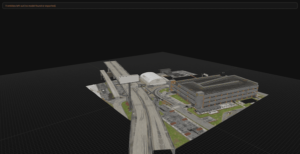</p>

> [!WARNING]
> OpenVI is in early development. Installers are on the [releases page](https://github.com/TheoBIET/OpenVI/releases)
> (not code-signed yet); installed copies update themselves. It reads files you own and never decrypts, uploads or
> modifies them. Read [the legal notes](docs/LEGAL.md) before contributing.

## What it is

OpenVI is a desktop file explorer for a GTA VI install, in the tradition of OpenIV for the earlier games:
a folder tree on the left, a detailed list grouped by type on the right, and a path bar and filter on top. On top of
the explorer it builds a searchable index of the archives' contents, so you can find vehicles, weapons, missions and
assets the game never shows.

It runs on Windows, macOS and Linux.

## A look inside

Screenshots of OpenVI on its maintainer's own copy of the game.

<table>
  <tr>
    <td width="50%">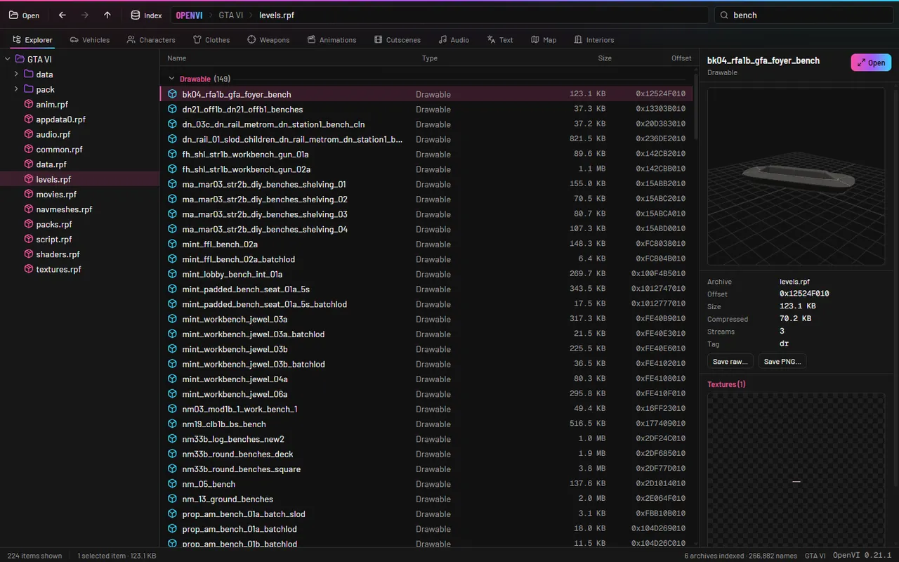<br /><sub><b>Explorer</b>: the archives opened like folders, resources by type, a click previews.</sub></td>
    <td width="50%">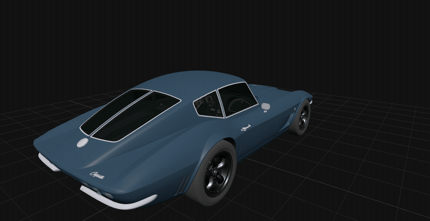<br /><sub><b>Vehicles</b>: every car of the catalog in 3D, in any of its configurations.</sub></td>
  </tr>
  <tr>
    <td>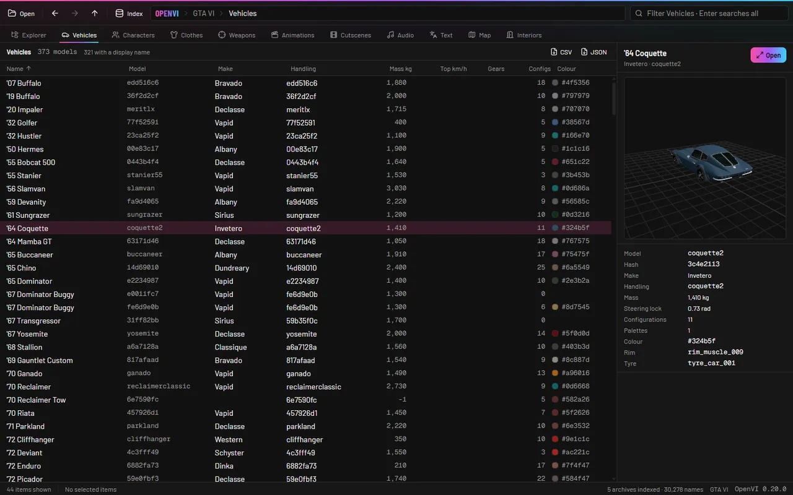<br /><sub><b>Vehicle catalog</b>: make, handling, mass, configurations; CSV and JSON export.</sub></td>
    <td>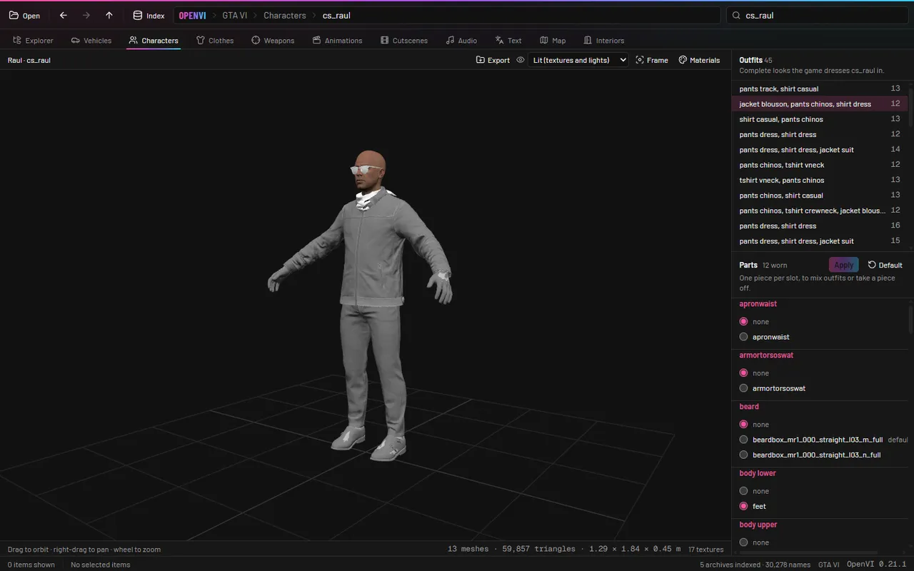<br /><sub><b>Characters</b>: 2,900 characters and ped models, dressed in the game's outfits or part by part.</sub></td>
  </tr>
  <tr>
    <td>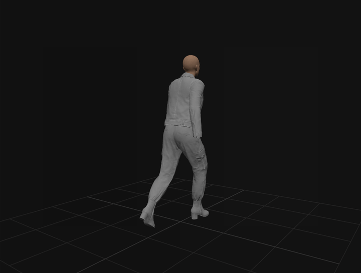<br /><sub><b>Animations</b>: 61,500 clip dictionaries, played on a character or its skeleton.</sub></td>
    <td>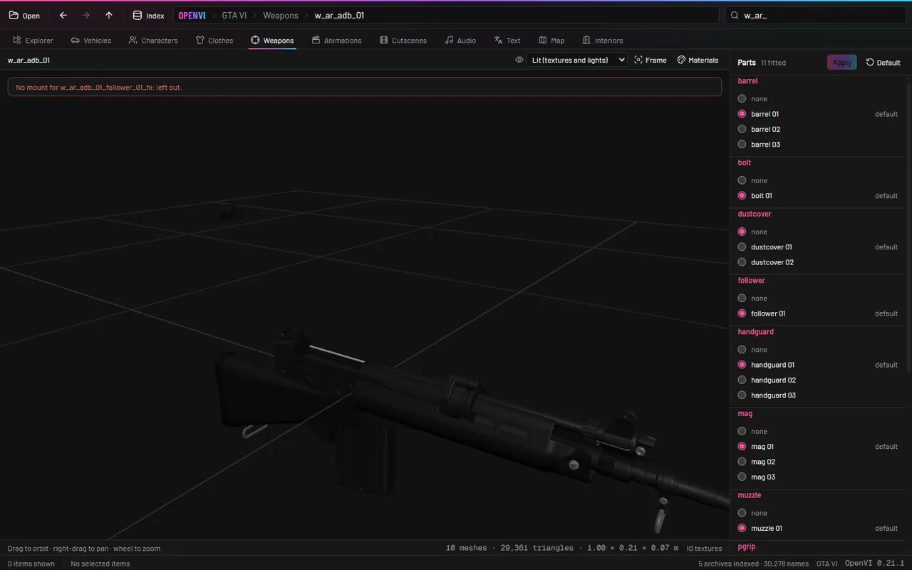<br /><sub><b>Weapons</b>: built from their parts (barrel, stock, magazine, sights…).</sub></td>
  </tr>
  <tr>
    <td>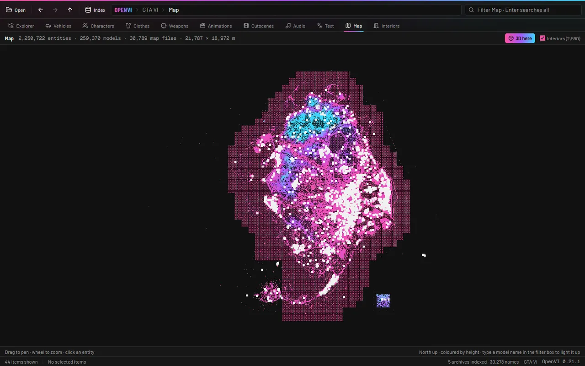<br /><sub><b>Map</b>: 2.2 million placed entities from above, coloured by height, interiors marked.</sub></td>
    <td>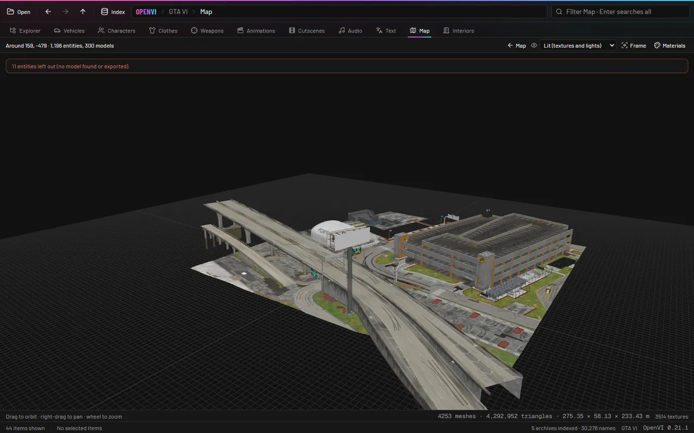<br /><sub><b>Map in 3D</b>: any area rebuilt from its models, each where the game places it.</sub></td>
  </tr>
  <tr>
    <td>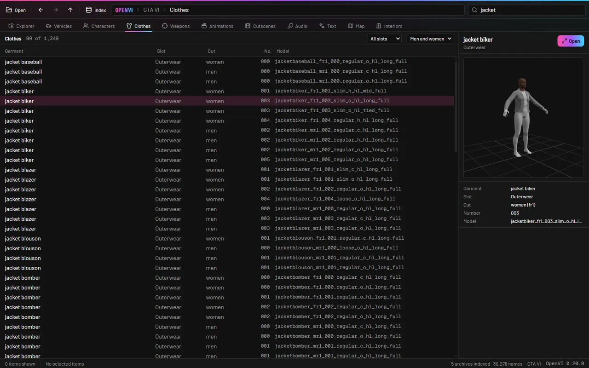<br /><sub><b>Clothes</b>: 1,349 garments by slot and cut, tried on a mannequin.</sub></td>
    <td>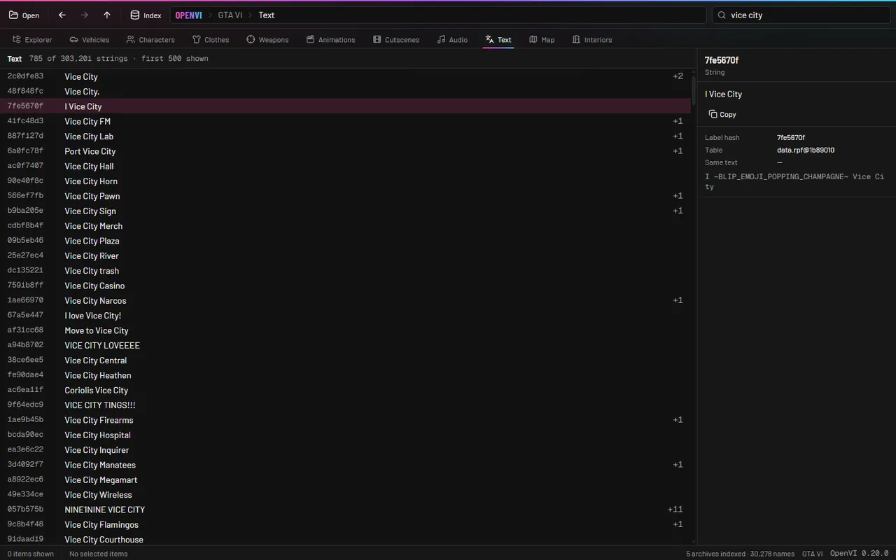<br /><sub><b>Text</b>: 300,000 English strings searched as you type.</sub></td>
  </tr>
</table>

Also: cutscenes (1,240 scenes, played by their cast), the audio banks (played and saved), interiors, textures,
documents in a code editor, and glTF, PNG, CSV and JSON exports.

## Roadmap

| Feature                                                                     | Status     |
| --------------------------------------------------------------------------- | ---------- |
| Explorer: folder tree, grouped details list, path bar, filter, history      | ✅ done    |
| Archive view: resources inside RPF9 archives, by type, with recovered names | ✅ done    |
| Viewers and exports: 3D models, textures, text, audio; glTF, PNG, CSV, JSON | ✅ done    |
| Search: resource names across the index, and the game's text                | ✅ done    |
| Sections: vehicles, characters, clothes, weapons, animations, cutscenes     | ✅ done    |
| Map in the spirit of CodeWalker: from above, areas in 3D, interiors         | 🚧 started |
| Missions, hidden content, hash names, garment colours                       | 💭 next    |
| Modding (replacing files) through a PC compatibility layer's overlay        | 💭 later   |

> [!NOTE]
> The table of contents of RPF9 archives is encrypted, and OpenVI does not decrypt it. Inside an archive you will
> see resources grouped by type, named where the name can be recovered from the data itself, not the original folder
> tree. See [ARCHITECTURE.md](docs/ARCHITECTURE.md#what-the-encrypted-table-of-contents-means).

## How it works

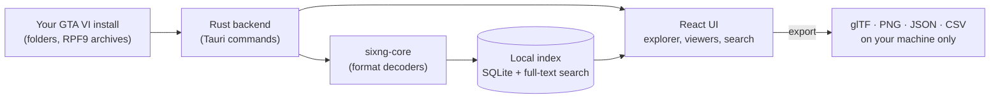

## Built by AI

OpenVI is developed entirely by AI agents ([Claude Code](https://claude.com/claude-code)): code, documentation and
design. The maintainer decides what gets built and tests it on real hardware. Human and agent contributions follow the
same rules ([CONTRIBUTING.md](CONTRIBUTING.md)).

## Build from source

**Prerequisites**

- [Node.js](https://nodejs.org) 26.13 (see [`.nvmrc`](.nvmrc)) and [pnpm](https://pnpm.io) 12
- [Rust](https://rustup.rs) 1.90 or newer
- The [Tauri 2 system prerequisites](https://v2.tauri.app/start/prerequisites/) for your OS

```sh
git clone https://github.com/TheoBIET/OpenVI.git
cd OpenVI
pnpm install
pnpm dev          # runs the desktop app with hot reload
```

| Command                                                              | What it does                              |
| -------------------------------------------------------------------- | ----------------------------------------- |
| `pnpm dev`                                                           | Desktop app in development mode           |
| `pnpm --filter @openvi/desktop build:desktop`                        | Release build and installers for your OS  |
| `pnpm lint` · `pnpm check-types`                                     | Lint (oxlint) and type-check the frontend |
| `pnpm format`                                                        | Format with oxfmt                         |
| `cargo clippy --workspace -- -D warnings` · `cargo test --workspace` | Lint and test the Rust backend            |

## Project layout

```text
apps/desktop/          the app
  src/                 React UI (explorer components, lib/)
  src-tauri/           Rust backend: Tauri commands, file system access
apps/site/             the GitHub Pages presentation page
packages/theme/        shared visual identity (fonts, colour tokens)
packages/typescript/   shared TypeScript configuration
docs/                  architecture and legal notes
```

## Contributing

Contributions are welcome. Read [CONTRIBUTING.md](CONTRIBUTING.md) first: the clean-room rules in particular are not
negotiable. Please follow the [Code of Conduct](CODE_OF_CONDUCT.md). Security issues go through
[SECURITY.md](SECURITY.md).

## Acknowledgements

OpenVI stands on the research of the GTA VI reverse-engineering community, in particular
[SixNG](https://github.com/holdmysocks/SixNG) (format decoders, OpenVI's core),
[bcpack-rs](https://github.com/Ahmet-Dedeler/bcpack-rs),
[GTA6-Asset-Info](https://github.com/TrinitronClient/GTA6-Asset-Info) and the list at
[awesome-gta6-reverse-engineering](https://github.com/Ahmet-Dedeler/awesome-gta6-reverse-engineering).
The explorer layout pays tribute to [OpenIV](https://openiv.com); OpenVI is not affiliated with it.

## License

OpenVI is free software under the [GNU General Public License v3.0 only](LICENSE).

OpenVI is an unofficial fan project, not affiliated with, endorsed by or sponsored by Rockstar Games, Take-Two
Interactive or the OpenIV team. Grand Theft Auto and related names are trademarks of their respective owners.
OpenVI ships no game files and decrypts nothing: it reads the unencrypted data of files you own, for interoperability
and research.
