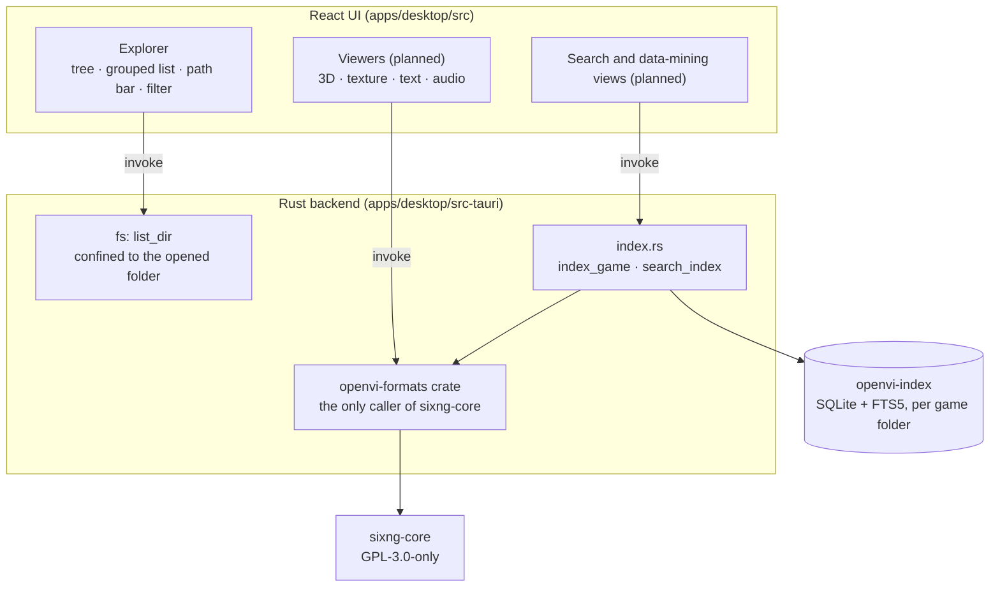

# Architecture

OpenVI is a Tauri 2 desktop app: a Rust backend that touches the file system and decodes game formats, and a React UI
that talks to it through Tauri commands. Everything runs locally.

## Decisions

| Decision                                                    | Why                                                                                                                                                                                     |
| ----------------------------------------------------------- | --------------------------------------------------------------------------------------------------------------------------------------------------------------------------------------- |
| Explorer first, in the OpenIV tradition                     | It is the tool people expect; data-mining views are built on top of it, not instead of it.                                                                                              |
| Tauri 2 + React                                             | Small native binaries on all three desktop OSes; the UI is web code.                                                                                                                    |
| `sixng-core` as a Rust library, pinned to one commit        | It already decodes RPF9 resources, models (glTF), textures, text, placements and metadata. Linking it gives fast, on-demand previews from one executable.                               |
| One adapter module is the only code that calls `sixng-core` | SixNG changes several times an hour; an update then touches one module.                                                                                                                 |
| GPL-3.0-only                                                | Required by `sixng-core`, and it keeps OpenVI and its forks open.                                                                                                                       |
| A local SQLite index with full-text search                  | Archives have no readable table of contents, so content is found by scanning once; the index makes every later search instant. One index per game version allows diffs between updates. |

Alternatives considered: driving `sixng-cli` as a separate process (simpler, but slow full exports and per-preview
process launches), and writing new decoders from scratch (months of work SixNG has already done).

## What the encrypted table of contents means

An RPF9 archive is like a zip: an index (names, folders, offsets, sizes) followed by the data. The data blocks are
plain zlib; the index is encrypted, and OpenVI does not decrypt it ([LEGAL.md](LEGAL.md)). So:

1. Inside an archive there is no original folder tree. Resources are found by scanning the data and grouped by type.
2. Names are recovered where the data carries them (models store their own name) or by matching hashes against known
   names. Each newly recovered name applies to the whole index.
3. Opening a game folder the first time means one indexing pass; afterwards the index answers.
4. Writing archives would mean rewriting the encrypted index, so modding is out of scope until a PC compatibility
   layer can substitute files at read time.

## Explorer today

`list_dir(root, path)` returns the entries of one folder (folders, then `.rpf` archives, then other files), the
breadcrumb from the opened folder down, and each folder's item count. The backend canonicalises both paths and
refuses any path outside the opened folder. Symbolic links and dot-files are left out.

`open_archive(root, path)` returns the same `Listing` for an `.rpf`: one `resource` entry per carved resource (name
or offset, type, inflated size, offset), sorted by type then name, and the breadcrumb ends on the archive. The first
opening scans the archive and emits `archive-progress` events (`carving` in bytes, then `naming` in resources); the
scan is cached in the app cache folder (`archives/`), so later openings answer at once. The list renders only the
visible rows (fixed row heights), for archives of hundreds of thousands of resources.

## Formats adapter

`crates/openvi-formats` is the only crate that depends on `sixng-core` (pinned to one commit, without libopus). It
exposes its own types, so a SixNG update stops there:

- `read_header(path)`: the plain part of an RPF9 header (where the data starts, announced entry count, whether the
  table of contents looks encrypted).
- `scan_archive(path, archive_id, cache_dir, progress)`: carves the zlib streams of the data area into
  `ArchiveEntry` values (offset, sizes, `ResourceKind`). The scan is streamed, runs in parallel 256 MiB segments,
  checkpoints each segment in `cache_dir` and is read back from there until the archive changes. A second pass
  reads the name each RAGE resource carries in its own data (`<name>.#<tag>`; the tag gives the type: drawable,
  fragment, drawable or texture dictionary) and is cached with the scan.
- `resource_details(path, archive_id, cache_dir, offset)`: one scanned resource with its stream count and the
  textures it holds (texture dictionaries, and models with embedded textures).
- `texture_png(..., offset, index, max_size)`: one texture decoded (Xbox tiling removed, BCn and plain formats) and
  encoded as PNG, at the largest mip that fits `max_size`.
- `resource_text(..., offset, max_bytes)`: the start of an XML or plain-text resource.
- `catalog::vehicle_catalog(game_root, work_dir, progress)`: scans `packs.rpf` and `data.rpf` if needed, then lets
  SixNG decode the vehicle tables (`vehicles::build`) and the handling records (`pso::export_handling`) into
  `<work>/catalog`, and joins them into one row per model (`vehicle_rows`, tested on hand-written JSON).
  The work folder is SixNG's layout: scans in `<work>/index`, which is the app's scan cache.
- Feature `fixtures`: a synthetic archive (DDS, PNG, XML, a named fragment, a texture dictionary holding one 64×64
  texture) for the tests of other crates.
- `model::model_glb(game_root, work_dir, archive_id, offset)`: a drawable, fragment or drawable dictionary exported
  by SixNG (`export_many`) to `<work>/models/.../model.glb`, PNG textures beside it; an earlier export is reused.
- `model::vehicle_glb(game_root, work_dir, model, config, progress)`: a vehicle of the catalog in one spawn
  configuration with its wheels (`vehexport::export_vehicle`, models from `levels.rpf`), to `<work>/vehicles`.

All of them read the scan cache: a resource is reached by its archive and offset. Hash → name lookups
(`sixng_core::names`) are not wired yet.

## Viewers

Selecting a resource opens the properties panel (`PropertiesPanel.tsx`): archive, offset, sizes, streams, sub type
and tag; the textures a resource holds, listed with a PNG preview (`texture_preview` returns raw bytes through
`tauri::ipc::Response`, shown through an object URL). Details load
150 ms after the selection settles, because loading a model inflates all of it.

Double-clicking (or Enter on) a loose file, or an XML, text or PNG resource, opens the document view
(`DocumentView.tsx`) in place of the list; Back, Up or Backspace close it. Loose files go through `file_preview`
(images by extension; otherwise text when the first 8 KB hold no NUL and valid UTF-8; else binary) and
`file_bytes`. Text shows in Monaco, read-only (`CodeView.tsx`): bundled locally, never from a CDN, and loaded with
`import()` on the first document, so it costs nothing at start-up. Its theme uses the colour tokens; XML and JSON can
be laid out (`lib/prettify.ts`), and the language is picked from the extension or the first characters.

Models (drawables, fragments, drawable dictionaries) open in the 3D view (`ModelView.tsx`, `lib/scene.ts`):
three.js, loaded with `import()` like Monaco, orbit controls, the model standing on a grid at the origin (glTF is
Y-up, in metres), reframe, and five render modes (Lit, Unlit, Clay, Normals, Wire: `RenderMode`). `model_preview` and `vehicle_preview` return the path of the GLB SixNG
wrote; the frontend loads it with `convertFileSrc` through Tauri's asset protocol, which is scoped to
`$APPCACHE/work/models` and `$APPCACHE/work/vehicles`, because the GLB names its PNG textures by relative path.

## Catalogs

`catalog.rs` (app) builds the vehicle catalog: it scans `packs.rpf` and `data.rpf` with the per-archive lock and
records them in the index (progress as `catalog-progress` events), then calls `openvi_formats::catalog`. The view
(`VehiclesView.tsx`) is a sortable table narrowed by the filter box, exported as CSV or JSON through the save dialog
and `save_export` (writes `.csv` and `.json` only). The frontend keeps one catalog per game folder per session.

Sections (`SectionTabs.tsx`) switch between the explorer and the catalogs; a catalog takes the whole width. The
Characters section (`characters.rs` in the app, `openvi_formats::characters`) lists what `sixng_core::outfit` can
assemble from `packs.rpf`, the parts of one by slot, and exports a look (a set of part offsets) with
`outfit::export_outfit` into `<cache>/work/characters/<sources>/<name>_<look hash>/`, reused until `packs.rpf` or a
texture store changes. Every ped model of the game's outfit list is listed too (`pedlook::listed_models`, named
from `packs.rpf` and the text of `data.rpf`); a model without parts named after it wears the parts of the outfits
`pedlook::look` gives it (`character_parts` returns the parts and the outfits). The 3D view's animation bar plays any animations a GLB carries (`THREE.AnimationMixer`).

The Animations section (`animations.rs` in the app, `openvi_formats::animations`) lists the clip dictionaries of
`anim.rpf` (`sixng_core::anim::dictionaries`, cached in `<work>/index/anim.clipdicts.json`, dropped when `anim.rpf`
is newer) and their clips; a clip plays through `character_glb` with a clip, which hands it to `export_outfit`
(bone tracks on the joints of the same name; `anim_only` for the skeleton alone). The look folder's name includes
the clip, and its sources `anim.rpf`'s state.

## Clothes

`openvi_formats::clothes` lists the generic garments of `packs.rpf`: drawables with a fit tag (`mr1`, `fr1`…) and no
character prefix (`outfit::outfit_prefix`), whose slot (`pedlook::slot_of`) is a garment's (full, outer, top,
bottom, feet). A garment is tried on a mannequin of its fit (the fit's skin meshes `hand_<fit>_000_full` and
`feet_<fit>_000_full`, and its first generic head), assembled through `character_glb` like a character.

## Weapons

`openvi_formats::weapons` lists the weapon models (`sixng_core::weapon::is_weapon`, `_hi` copy first) of `data.rpf` and
`packs.rpf` and their parts (`weapon_options`). An assembly exports the base and each part like any model
(`model_glb`), reads each one's bones from the `model.json` beside its GLB, places the parts with
`weapon::place` (RAGE Z-up, converted to glTF Y-up) and writes a manifest (`<work>/weapons/.../*.weapon.json`: GLB
paths and matrices). The 3D view loads a manifest as one model (`lib/scene.ts`, `isAssembly`); Export and Materials
are hidden for it.

## Releases and updates

`release.yml` runs on a `v*` tag: one job creates the release as a draft with that version's CHANGELOG section, then one job
per platform builds the installers with `tauri-action` and uploads them with their update bundles, signed with the
updater key, and `latest.json` (merged across platforms; Windows points at the NSIS setup); a last job publishes it once every platform built, so `releases/latest` never
points at a release without its `latest.json`. Installed copies read
`releases/latest/download/latest.json` (`plugins.updater` in `tauri.conf.json`, which holds the public key),
check the signature, install (passive NSIS on Windows) and restart through `tauri-plugin-process`. Development
builds never check.

## Index

`crates/openvi-index` keeps the scans in SQLite (bundled, WAL), one database per game folder in the app's local data
folder (`index/<folder>-<hash>.sqlite`; the game version cannot be read from the files yet, so it is per folder).
Tables `archives` (path, size, modification time) and `resources` (offset, size, type, name), plus an FTS5 table of
names with the trigram tokenizer, so any part of a name matches (`bench` finds `prop_bench_01`). Results come best
first: exact name, then names starting with the query, then shorter names. The schema is versioned; a mismatch
rebuilds the index, which is only a cache of scans.

The index fills two ways: opening an archive records its scan, and `index_game` scans every `.rpf` of the folder that
changed since it was indexed, one at a time, emitting `index-progress` events. In the UI, typing in the filter box
filters the list; Enter searches the whole index, and opening a result opens its archive with the resource selected.

## Performance and progress

- Scan indexes are parsed once and kept in memory (`openvi_formats::index_cache`) until their file changes; an up to
  date scan returns from there. Every adapter function that needs an index (resource details, model and vehicle
  exports, characters, clip names, the catalog's handling) reads it through that cache.
- Exports keep decoded textures: a character's looks and clips share `<cache>/work/characters/<sources>/<name>/`, a
  vehicle's configurations `<cache>/work/vehicles/<sources>/<model>/`, models `<cache>/work/models/<sources>/`; SixNG
  runs without `force`, which it gets only when that left no GLB.
- Every dependency is optimised in dev builds (`[profile.dev.package."*"]`), since `pnpm dev` is a debug build.
- Long operations behind the sections report each step as `catalog-progress` (`progress.rs`: label, count, bytes or
  items); a scan waiting for the same archive's scan started elsewhere says so (`scans::scan_reported`). The frontend
  shows a filled bar for a counted step and a sweeping bar otherwise (`LoadingPanel.tsx`).
- The vehicle catalog's tables (`<work>/catalog`) are decoded again only when `packs.rpf` or `data.rpf` is newer.
- An archive changed in the last ten minutes and no smaller than when scanned is taken as being written (a download):
  its earlier scan is used until it settles (`current_scan`). A finished scan removes its segment checkpoints
  (`<work>/index/<archive>.segs`), which SixNG keys by size and time.
- The game text (`openvi_formats::text`): English tables told apart by their words, read once per state of
  `data.rpf` into `<work>/index/text.<state>.json` and memory, searched in memory.
- Windows: `build.rs` embeds tauri-build's manifest (Common Controls 6) in every executable through the linker, so the
  test executables start.
- Animations: the character is assembled once (`character_glb` without a clip); a clip is exported on its own with
  `skeleton_only` (no meshes or textures) and loaded onto the model on screen (`SceneHandle.loadAnimations`): three.js
  binds its tracks to the joints of the same name, which SixNG builds from the same parts. The last clip dictionary
  stays in memory (`animations::load_dictionary`). A model without meshes is drawn as its bones.
