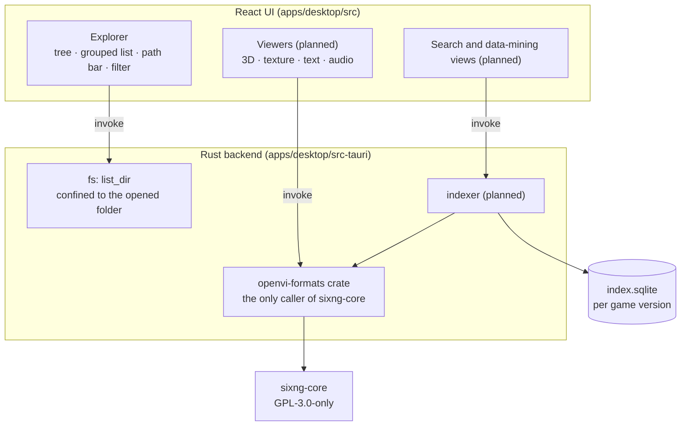

# Architecture

OpenVI is a Tauri 2 desktop app: a Rust backend that touches the file system and decodes game formats, and a React UI
that talks to it through Tauri commands. Everything runs locally.

## Decisions

| Decision                                                    | Why                                                                                                                                                                                     |
| ----------------------------------------------------------- | --------------------------------------------------------------------------------------------------------------------------------------------------------------------------------------- |
| Explorer first, in the OpenIV tradition                     | It is the tool people expect; data-mining views are built on top of it, not instead of it.                                                                                              |
| Tauri 2 + React                                             | Small native binaries on all three desktop OSes; the UI is web code.                                                                                                                    |
| `sixng-core` as a Rust library, pinned to one commit        | It already decodes RPF9 resources, models (glTF), textures, text, placements and metadata. Linking it gives fast, on-demand previews from one executable.                               |
| One adapter module is the only code that calls `sixng-core` | SixNG changes several times an hour; an update then touches one module.                                                                                                                 |
| GPL-3.0-only                                                | Required by `sixng-core`, and it keeps OpenVI and its forks open.                                                                                                                       |
| A local SQLite index with full-text search                  | Archives have no readable table of contents, so content is found by scanning once; the index makes every later search instant. One index per game version allows diffs between updates. |

Alternatives considered: driving `sixng-cli` as a separate process (simpler, but slow full exports and per-preview
process launches), and writing new decoders from scratch (months of work SixNG has already done).

## What the encrypted table of contents means

An RPF9 archive is like a zip: an index (names, folders, offsets, sizes) followed by the data. The data blocks are
plain zlib; the index is encrypted, and OpenVI does not decrypt it ([LEGAL.md](LEGAL.md)). So:

1. Inside an archive there is no original folder tree. Resources are found by scanning the data and grouped by type.
2. Names are recovered where the data carries them (models store their own name) or by matching hashes against known
   names. Each newly recovered name applies to the whole index.
3. Opening a game folder the first time means one indexing pass; afterwards the index answers.
4. Writing archives would mean rewriting the encrypted index, so modding is out of scope until a PC compatibility
   layer can substitute files at read time.

## Explorer today

`list_dir(root, path)` returns the entries of one folder (folders, then `.rpf` archives, then other files), the
breadcrumb from the opened folder down, and each folder's item count. The backend canonicalises both paths and
refuses any path outside the opened folder. Symbolic links and dot-files are left out.

`open_archive(root, path)` returns the same `Listing` for an `.rpf`: one `resource` entry per carved resource (name
or offset, type, inflated size, offset), sorted by type then name, and the breadcrumb ends on the archive. The first
opening scans the archive and emits `archive-progress` events (`carving` in bytes, then `naming` in resources); the
scan is cached in the app cache folder (`archives/`), so later openings answer at once. The list renders only the
visible rows (fixed row heights), for archives of hundreds of thousands of resources.

## Formats adapter

`crates/openvi-formats` is the only crate that depends on `sixng-core` (pinned to one commit, without libopus). It
exposes its own types, so a SixNG update stops there:

- `read_header(path)`: the plain part of an RPF9 header (where the data starts, announced entry count, whether the
  table of contents looks encrypted).
- `scan_archive(path, archive_id, cache_dir, progress)`: carves the zlib streams of the data area into
  `ArchiveEntry` values (offset, sizes, `ResourceKind`). The scan is streamed, runs in parallel 256 MiB segments,
  checkpoints each segment in `cache_dir` and is read back from there until the archive changes. A second pass
  reads the name each RAGE resource carries in its own data (`<name>.#<tag>`; the tag gives the type: drawable,
  fragment, drawable or texture dictionary) and is cached with the scan.
- Feature `fixtures`: a synthetic archive for the tests of other crates.

Hash → name lookups (`sixng_core::names`) and resource decoding come with the index and the viewers.
