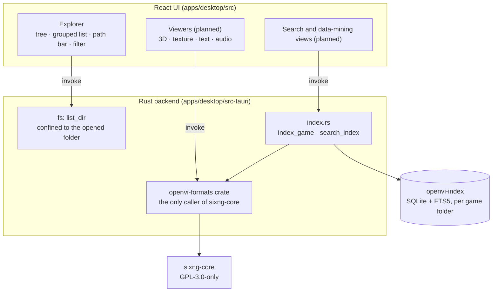

# Architecture

OpenVI is a Tauri 2 desktop app: a Rust backend that touches the file system and decodes game formats, and a React UI
that talks to it through Tauri commands. Everything runs locally.

## Decisions

| Decision                                                    | Why                                                                                                                                                                                     |
| ----------------------------------------------------------- | --------------------------------------------------------------------------------------------------------------------------------------------------------------------------------------- |
| Explorer first, in the OpenIV tradition                     | It is the tool people expect; data-mining views are built on top of it, not instead of it.                                                                                              |
| Tauri 2 + React                                             | Small native binaries on all three desktop OSes; the UI is web code.                                                                                                                    |
| `sixng-core` as a Rust library, pinned to one commit        | It already decodes RPF9 resources, models (glTF), textures, text, placements and metadata. Linking it gives fast, on-demand previews from one executable.                               |
| One adapter module is the only code that calls `sixng-core` | SixNG changes several times an hour; an update then touches one module.                                                                                                                 |
| GPL-3.0-only                                                | Required by `sixng-core`, and it keeps OpenVI and its forks open.                                                                                                                       |
| A local SQLite index with full-text search                  | Archives have no readable table of contents, so content is found by scanning once; the index makes every later search instant. One index per game version allows diffs between updates. |

Alternatives considered: driving `sixng-cli` as a separate process (simpler, but slow full exports and per-preview
process launches), and writing new decoders from scratch (months of work SixNG has already done).

## What the encrypted table of contents means

An RPF9 archive is like a zip: an index (names, folders, offsets, sizes) followed by the data. The data blocks are
plain zlib; the index is encrypted, and OpenVI does not decrypt it ([LEGAL.md](LEGAL.md)). So:

1. Inside an archive there is no original folder tree. Resources are found by scanning the data and grouped by type.
2. Names are recovered where the data carries them (models store their own name) or by matching hashes against known
   names. Each newly recovered name applies to the whole index.
3. Opening a game folder the first time means one indexing pass; afterwards the index answers.
4. Writing archives would mean rewriting the encrypted index, so modding is out of scope until a PC compatibility
   layer can substitute files at read time.

## Explorer today

`list_dir(root, path)` returns the entries of one folder (folders, then `.rpf` archives, then other files), the
breadcrumb from the opened folder down, and each folder's item count. The backend canonicalises both paths and
refuses any path outside the opened folder. Symbolic links and dot-files are left out.

`open_archive(root, path)` returns the same `Listing` for an `.rpf`: one `resource` entry per carved resource (name
or offset, type, inflated size, offset), sorted by type then name, and the breadcrumb ends on the archive. The first
opening scans the archive and emits `archive-progress` events (`carving` in bytes, then `naming` in resources); the
scan is cached in the app cache folder (`archives/`), so later openings answer at once. The list renders only the
visible rows (fixed row heights), for archives of hundreds of thousands of resources.

## Formats adapter

`crates/openvi-formats` is the only crate that depends on `sixng-core` (pinned to one commit, without libopus). It
exposes its own types, so a SixNG update stops there:

- `read_header(path)`: the plain part of an RPF9 header (where the data starts, announced entry count, whether the
  table of contents looks encrypted).
- `scan_archive(path, archive_id, cache_dir, progress)`: carves the zlib streams of the data area into
  `ArchiveEntry` values (offset, sizes, `ResourceKind`). The scan is streamed, runs in parallel 256 MiB segments,
  checkpoints each segment in `cache_dir` and is read back from there until the archive changes. A second pass
  reads the name each RAGE resource carries in its own data (`<name>.#<tag>`; the tag gives the type: drawable,
  fragment, drawable or texture dictionary) and is cached with the scan.
- `resource_details(path, archive_id, cache_dir, offset)`: one scanned resource with its stream count and the
  textures it holds (texture dictionaries, and models with embedded textures).
- `texture_png(..., offset, index, max_size)`: one texture decoded (Xbox tiling removed, BCn and plain formats) and
  encoded as PNG, at the largest mip that fits `max_size`.
- `resource_text(..., offset, max_bytes)`: the start of an XML or plain-text resource.
- `catalog::vehicle_catalog(game_root, work_dir, progress)`: scans `packs.rpf` and `data.rpf` if needed, then lets
  SixNG decode the vehicle tables (`vehicles::build`) and the handling records (`pso::export_handling`) into
  `<work>/catalog`, and joins them into one row per model (`vehicle_rows`, tested on hand-written JSON).
  The work folder is SixNG's layout: scans in `<work>/index`, which is the app's scan cache.
- Feature `fixtures`: a synthetic archive (DDS, PNG, XML, a named fragment, a texture dictionary holding one 64×64
  texture) for the tests of other crates.

All of them read the scan cache: a resource is reached by its archive and offset. Hash → name lookups
(`sixng_core::names`) and model export are not wired yet.

## Viewers

Selecting a resource opens the properties panel (`PropertiesPanel.tsx`): archive, offset, sizes, streams, sub type
and tag; the textures a resource holds, listed with a PNG preview (`texture_preview` returns raw bytes through
`tauri::ipc::Response`, shown through an object URL). Details load
150 ms after the selection settles, because loading a model inflates all of it.

Double-clicking (or Enter on) a loose file, or an XML, text or PNG resource, opens the document view
(`DocumentView.tsx`) in place of the list; Back, Up or Backspace close it. Loose files go through `file_preview`
(images by extension; otherwise text when the first 8 KB hold no NUL and valid UTF-8; else binary) and
`file_bytes`. Text shows in Monaco, read-only (`CodeView.tsx`): bundled locally, never from a CDN, and loaded with
`import()` on the first document, so it costs nothing at start-up. Its theme uses the colour tokens; XML and JSON can
be laid out (`lib/prettify.ts`), and the language is picked from the extension or the first characters.

## Index

`crates/openvi-index` keeps the scans in SQLite (bundled, WAL), one database per game folder in the app's local data
folder (`index/<folder>-<hash>.sqlite`; the game version cannot be read from the files yet, so it is per folder).
Tables `archives` (path, size, modification time) and `resources` (offset, size, type, name), plus an FTS5 table of
names with the trigram tokenizer, so any part of a name matches (`bench` finds `prop_bench_01`). Results come best
first: exact name, then names starting with the query, then shorter names. The schema is versioned; a mismatch
rebuilds the index, which is only a cache of scans.

The index fills two ways: opening an archive records its scan, and `index_game` scans every `.rpf` of the folder that
changed since it was indexed, one at a time, emitting `index-progress` events. In the UI, typing in the filter box
filters the list; Enter searches the whole index, and opening a result opens its archive with the resource selected.
